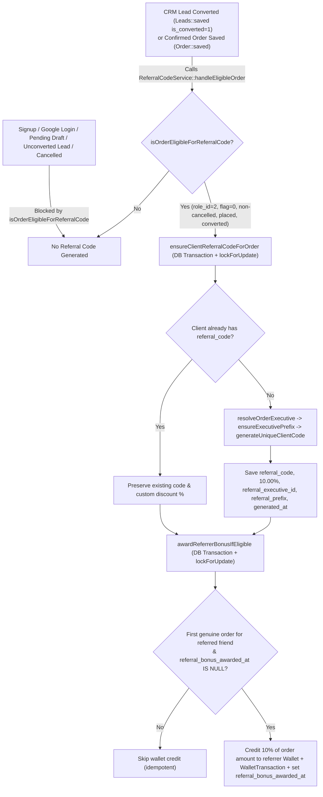
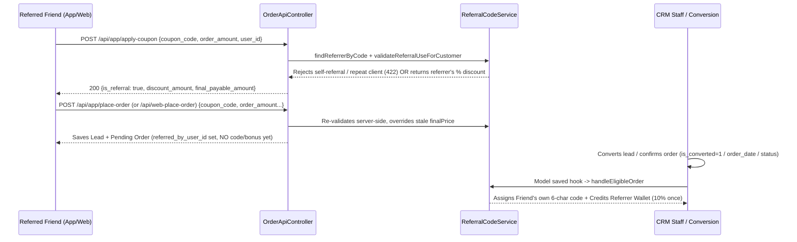

# Client Individual Referral Code System — Technical & Testing Guide

Comprehensive documentation for the **Client Individual Referral Code System** in `ain-backend`, covering architecture, database schema, trigger rules, code generation logic, double-sided checkout & wallet rewards, role-based access control (RBAC), file-by-file responsibilities, local testing workflows, and UAT/production deployment steps.

---

## 1. Core Business Rules

1. **Strict Trigger (Converted / Confirmed Placed Orders Only)**
   - A client (`users.role_id = 2`, `users.flag = 0`) receives an individual referral code **strictly once**, when an order first qualifies as a genuine **Converted / Confirmed Placed Order**.
   - **Never triggers on:**
     - Client signup (`/api/app/register`, `/api/app/google-login`)
     - Viewing referral info (`GET /api/app/refer-list`, `GET /api/app/referral-info`)
     - Unconverted leads (`leads.is_converted = 0`)
     - Undated `Pending` checkout drafts (`order_date IS NULL` and status blank/`Pending`)
     - Cancelled or Trash orders (`projectstatus IN ('Cancelled', 'Trash')`)
     - Staff accounts (`role_id != 2`) or deleted accounts (`flag != 0`)
2. **No Backfill Policy**
   - Existing legacy clients without referral codes are **not** backfilled in bulk.
   - Any existing client receives a code automatically when they place/convert their **next** eligible genuine order; brand-new clients receive one upon their **first** converted order.
   - Repeat orders by an already-coded client preserve their existing `referral_code`, `referral_discount_percent`, and `referral_executive_id`.
3. **6-Character Code Format (`[3-Char Exec Prefix][3-Char Suffix]`)**
   - Total length: **6 characters** (uppercase alphanumeric).
   - **First 3 characters:** Persistent 3-character identifier of the converting/assigned Marketing Executive or Admin (`users.referral_prefix`, e.g., `USK`, `PIY`, `MAX`, fallback `AIN`).
   - **Last 3 characters:** Unambiguous random suffix drawn from `ABCDEFGHJKLMNPQRSTUVWXYZ23456789` (excludes confusing `0`, `O`, `1`, `I`).
   - **Global Uniqueness:** Guaranteed unique (case-insensitive) across **both** `users.referral_code` and `coupons.coupon_code`.
4. **Default 10% Discount + Double-Sided Reward**
   - Every generated code defaults to `referral_discount_percent = 10.00%` (editable between `0.00` and `100.00` by Admin / Sub Admin).
   - **Referred Friend Benefit (First Order Only):** Applies the referrer's configured `referral_discount_percent` on `/api/app/apply-coupon`, `/api/app/place-order`, and `/api/web-place-order`. Self-referrals and repeat referral usage on subsequent orders are rejected (`422`).
   - **Referrer Benefit (Wallet Bonus):** Credits **10%** of the referred client's first genuine converted order payable `amount` into the referrer's `users.Wallet`, increments `users.total_referral_earnings`, and logs a `credit` row in `wallet_transactions` **strictly once** (protected by DB transaction + row locks + `orders.referral_bonus_awarded_at`).

---

## 2. End-to-End Architecture & Data Flow



### API Checkout Redemption Flow



---

## 3. Database Schema Changes

Migration file: [`database/migrations/2026_11_11_143000_add_client_individual_referral_system_columns.php`](file:///c:/xampp/htdocs/ain-backend/database/migrations/2026_11_11_143000_add_client_individual_referral_system_columns.php)

| Table | Column | Type / Default | Purpose |
| :--- | :--- | :--- | :--- |
| `users` | `referral_discount_percent` | `DECIMAL(5,2) NOT NULL DEFAULT 10.00` | Custom or default discount % offered when others use this user's referral code |
| `users` | `referral_executive_id` | `UNSIGNED BIGINT NULL` (indexed) | Foreign reference to the attributing staff executive (`users.id`) |
| `users` | `referral_prefix` | `VARCHAR(10) NULL` (indexed) | Staff's persistent 3-char prefix (for roles `1, 4, 9`) or snapshot prefix on client |
| `users` | `referral_code_generated_at` | `TIMESTAMP NULL` (indexed) | Exact timestamp when the client's referral code was first generated |
| `orders` | `referred_by_user_id` | `UNSIGNED BIGINT NULL` (indexed) | ID of the referring user whose referral code was applied on this order |
| `orders` | `referral_bonus_awarded_at` | `TIMESTAMP NULL` (indexed) | Atomic idempotency lock timestamp proving referrer wallet bonus was paid once |

*Existing columns leveraged alongside these:* `users.referral_code`, `users.refer_id`, `users.Wallet`, `users.total_referral_earnings`, `wallet_transactions.*`, `orders.coupon_code`, `orders.coupon_discount_amount`, `coupons.coupon_code`.

---

## 4. Referral Generation, Prefix Attribution & Eligibility Rules

Implemented cleanly in [`app/Services/ReferralCodeService.php`](file:///c:/xampp/htdocs/ain-backend/app/Services/ReferralCodeService.php):

### 4.1 Order Eligibility (`isOrderEligibleForReferralCode`)
An order triggers generation/payout **only when ALL pass**:
1. Migration columns exist (`users.referral_code_generated_at`).
2. `orders.order_id` is non-empty and `orders.uid > 0`.
3. `orders.projectstatus` (lowercased/trimmed) is not `'cancelled'` or `'trash'`.
4. Either `orders.order_date` is set **or** `orders.projectstatus` is non-empty and not `'pending'`.
5. Customer exists with `users.role_id = 2` and `users.flag = 0`.
6. If a `$lead` model is passed, `$lead->is_converted != 0`.
7. No active unconverted lead (`leads.is_converted = 0`, matching `orders.lead_id` or non-duplicate `orders.order_id`) exists in `leads`.

### 4.2 Executive Attribution Priority (`resolveOrderExecutive`)
Resolves the responsible staff executive in priority order:
1. `orders.l_converted_by` exact (case-insensitive) name match among active executive roles `[1, 4, 9]` (falling back to non-client `role_id != 2`), disambiguated using acting user, `orders.created_by`, or `leads.created_by`.
2. `orders.created_by` active staff user.
3. Linked `leads.created_by` active staff user.
4. Currently authenticated acting staff user (`Auth::user()`).
5. If none exist (e.g., pure self-checkout without staff attribution), falls back to prefix `'AIN'`.

### 4.3 Prefix Derivation (`derivePrefixCandidates` & `ensureExecutivePrefix`)
- If the executive already has a valid 3-character alphanumeric `users.referral_prefix`, it is reused permanently (Admins/Sub Admins can edit it manually).
- Otherwise, `derivePrefixCandidates($name)` tries:
  1. First 3 letters of word 1 (`Usk Kelvin` -> `USK`, `Piyush` -> `PIY`)
  2. Multi-word combinations (`2 letters of W1 + 1 of W2`, `1 of W1 + 2 of W2`, 3-word initials)
  3. Sliding letter combinations across the flattened name
  4. Deterministic stem + unambiguous character fallback (`2-9, K, M...`)
  - Picks the first candidate not already claimed in `users.referral_prefix` by another active staff member (`role_id IN [1, 4, 9]`).

### 4.4 Code Generation & Collision Guard (`generateUniqueClientCode` & `codeExistsAnywhere`)
- Combines `[3-char Prefix]` + 3 random characters from `ABCDEFGHJKLMNPQRSTUVWXYZ23456789`.
- Case-insensitively verifies `UPPER(code)` does not exist in `users.referral_code` or `coupons.coupon_code`.

---

## 5. Role-Based Access Control (RBAC) Matrix

Roles in `roles` table: `1` Super Admin, `2` User (Client), `3` Qc Executive, `4` Marketing Team, `5` Project Team, `6` WriterTL, `7` Sub Writer, `8` Writer Admin, `9` Sub Admin, `10` SEO, `11` Payment Role, `12` Hr.

| Feature / Surface | Super Admin (`1`) | Sub Admin (`9`) | Marketing Team (`4`) | All Other Roles (`3,5,6,7,8,10,11,12`) |
| :--- | :---: | :---: | :---: | :---: |
| `/user` — **Referral Code** column, code copy, % badge, Exec name | **View + Edit** | **View + Edit** | **View Only** | **Hidden** |
| `/user` — Search filter matches `users.referral_code` | Yes | Yes | Yes | Hidden in table |
| `/user` — Staff row `Prefix: XXX` badge & Edit Prefix modal | **View + Edit** | **View + Edit** | **View Only** | **Hidden** |
| `/user/report/{id}` — Referral Program Details card | **View + Inline Edit** | **View + Inline Edit** | **View Only** | **Hidden** |
| `POST /user/{id}/referral` & `POST /user/{id}` referral fields | **Allowed (200/422)** | **Allowed (200/422)** | **Blocked (403)** | **Blocked (403)** |
| `GET /user/referral-executives` (lazy dropdown JSON) | **Allowed (200)** | **Allowed (200)** | **Blocked (403)** | **Blocked (403)** |
| `/orders` — `Ref: CODE (PCT%)` badge & copy beside customer | **Visible** | **Visible** | **Visible** | **Hidden** |
| `/export-users` — `ReferralCode, ReferralDiscountPercent` CSV cols | **Included** | **Included** | N/A *(export route is Admin/SubAdmin)* | **Omitted** |
| `/search-refer-users` (Lead create/edit autocomplete) | Searches & returns code/% | Searches & returns code/% | Searches & returns code/% | Per route permission |

*Permission helpers:* [`ReferralCodeService::canView`](file:///c:/xampp/htdocs/ain-backend/app/Services/ReferralCodeService.php#L30-L33) (`[1, 4, 9]`) and [`ReferralCodeService::canEdit`](file:///c:/xampp/htdocs/ain-backend/app/Services/ReferralCodeService.php#L35-L38) (`[1, 9]`).
*Route middleware:* `user.referral.update` and `user.referral.executives` are mapped under `'user'` in [`CheckPermission.php`](file:///c:/xampp/htdocs/ain-backend/app/Http/Middleware/CheckPermission.php#L17-L22).

---

## 6. File-by-File Map ("Kaha Se Kya Hota Hai")

### Backend Core & Database
- [`database/migrations/2026_11_11_143000_add_client_individual_referral_system_columns.php`](file:///c:/xampp/htdocs/ain-backend/database/migrations/2026_11_11_143000_add_client_individual_referral_system_columns.php) — Schema changes and indexes for `users` and `orders`.
- [`app/Services/ReferralCodeService.php`](file:///c:/xampp/htdocs/ain-backend/app/Services/ReferralCodeService.php) — Central referral engine (RBAC, prefix derivation, code generation, uniqueness check, order eligibility, executive attribution, coupon validation, atomic wallet reward).
- [`app/Models/User.php`](file:///c:/xampp/htdocs/ain-backend/app/Models/User.php) — Added fillable/casts (`referral_discount_percent`, `referral_executive_id`, `referral_prefix`, `referral_code_generated_at`), `referralExecutive()` / `referredOrders()` relationships, and updated `generateUniqueReferralCode()` to delegate to `ReferralCodeService`.
- [`app/Models/Order.php`](file:///c:/xampp/htdocs/ain-backend/app/Models/Order.php) — Added `referred_by_user_id`, `referral_bonus_awarded_at`, `referredByUser()`, and `booted()` `static::saved` hook calling `handleEligibleOrder()`.
- [`app/Models/Leads.php`](file:///c:/xampp/htdocs/ain-backend/app/Models/Leads.php) — Updated `booted()` `static::saved` hook: when `is_converted == 1`, resolves linked `Order` (by `lead_id` or `order_id`) and invokes `handleEligibleOrder()`.

### Routes & Middleware
- [`routes/back-end.php`](file:///c:/xampp/htdocs/ain-backend/routes/back-end.php#L184-L188) — Registered `GET /user/referral-executives` (`user.referral.executives`) and `POST /user/{id}/referral` (`user.referral.update`) under `['auth', 'check.permission']`.
- [`app/Http/Middleware/CheckPermission.php`](file:///c:/xampp/htdocs/ain-backend/app/Http/Middleware/CheckPermission.php#L17-L22) — Whitelisted `user.referral.executives` and `user.referral.update` under module `'user'`.

### Controllers (API & CRM)
- [`app/Http/Controllers/Api/AuthController.php`](file:///c:/xampp/htdocs/ain-backend/app/Http/Controllers/Api/AuthController.php) —
  - `register()` & `googleLogin()`: No longer auto-generate `referral_code` on signup; case-insensitive lookup via `findReferrerByCode`.
  - `referList()`: No longer creates a referral code on demand; returns `has_referral_code`, `referral_code`, `referral_discount_percent`, and resolves bonus-awarded / genuine order cleanly even if first attempt was cancelled.
- [`app/Http/Controllers/Api/OrderApiController.php`](file:///c:/xampp/htdocs/ain-backend/app/Http/Controllers/Api/OrderApiController.php) —
  - `applyCoupon()`: Falls back to client referral code when no promo coupon matches; returns referrer discount %.
  - `placeOrder()` & `webPlaceOrder()`: Applies server-side referral discount, links `users.refer_id` and `orders.referred_by_user_id`, blocks self/repeat referral (`422` in `placeOrder`), skips premature wallet bonus on `Pending` drafts.
- [`app/Http/Controllers/UserController.php`](file:///c:/xampp/htdocs/ain-backend/app/Http/Controllers/UserController.php) —
  - `index()`: Eager-loads `referralExecutive`, searches `users.referral_code`.
  - `referralExecutives()`: Admin/Sub Admin JSON endpoint for lazy executive `<select>` loading.
  - `updateReferralSettings()` & `applyReferralSettingsToUser()`: Validates/saves referral code (`5–10` alphanumeric chars, globally unique across `users` + `coupons`), discount (`0–100%`), assigned executive, or staff 3-char prefix (`3` alphanumeric chars). Enforces `403` for non-`[1, 9]`.
  - `EditUser()`: Blocks non-`[1, 9]` from submitting referral fields (`403`) and applies updates when authorized.
  - `showUserProfile()`: Passes `$executives` for Admin/Sub Admin inline editing on profile page.
- [`app/Http/Controllers/LeadsController.php`](file:///c:/xampp/htdocs/ain-backend/app/Http/Controllers/LeadsController.php) — Updated `userData()`, `searchReferUsers()` (searches by `referral_code`), `convert()`, `convertLead()`, and `convertLeadData()`.
- [`app/Http/Controllers/OrderController.php`](file:///c:/xampp/htdocs/ain-backend/app/Http/Controllers/OrderController.php) — Included referral fields and `referralExecutive` in `orderListRelations()` eager load.
- [`app/Http/Controllers/ExportController.php`](file:///c:/xampp/htdocs/ain-backend/app/Http/Controllers/ExportController.php) — `exportUsers()` filters by `users.referral_code` and appends `ReferralCode, ReferralDiscountPercent` columns only when `ReferralCodeService::canView(auth()->user())` is true.

### Blade Views (CRM UI)
- [`resources/views/user/user_view.blade.php`](file:///c:/xampp/htdocs/ain-backend/resources/views/user/user_view.blade.php) — Added conditional **Referral Code** column header, updated search placeholder, shared `#editReferralModal` (rendered only for Admin/Sub Admin), lazy fetch of `/user/referral-executives`, and XSS-escaped AJAX DOM update.
- [`resources/views/user/partials/rows.blade.php`](file:///c:/xampp/htdocs/ain-backend/resources/views/user/partials/rows.blade.php) — Dynamic empty-state `colspan` (`10` when visible, `9` when hidden).
- [`resources/views/user/partials/row.blade.php`](file:///c:/xampp/htdocs/ain-backend/resources/views/user/partials/row.blade.php) — Renders client referral badge + copy button + `% OFF` + `Exec: Name (PFX)` (or staff `Prefix: XXX`), plus edit pencil button for `[1, 9]`. Fixed role display labels (`3`, `9`, `10`, `11`, `12`).
- [`resources/views/user/section/edit-section.blade.php`](file:///c:/xampp/htdocs/ain-backend/resources/views/user/section/edit-section.blade.php) — Added Referral Settings section inside user edit modal (lazy executive `<select>`, editable only by `[1, 9]`).
- [`resources/views/user/userreporting.blade.php`](file:///c:/xampp/htdocs/ain-backend/resources/views/user/userreporting.blade.php) — Added **Referral Program Details** card (`canView`) + inline edit form posting to `user.referral.update` (`canEdit`).
- [`resources/views/back-end/order/partials/row.blade.php`](file:///c:/xampp/htdocs/ain-backend/resources/views/back-end/order/partials/row.blade.php) — Renders `Ref: CODE (PCT%)` + copy button beside client contact info for `[1, 4, 9]`.
- [`resources/views/back-end/leads/partials/create.blade.php`](file:///c:/xampp/htdocs/ain-backend/resources/views/back-end/leads/partials/create.blade.php) & [`resources/views/back-end/leads/edit.blade.php`](file:///c:/xampp/htdocs/ain-backend/resources/views/back-end/leads/edit.blade.php) — Updated `#refer_search` autocomplete to search/display referral code + `%`.

---

## 7. API & CRM Endpoints Reference

| Endpoint | Method | Auth | Key Input Fields | Key Response Fields / Behavior |
| :--- | :---: | :--- | :--- | :--- |
| `/api/app/apply-coupon` | `POST` | Public | `coupon_code`, `order_amount`, `user_id` (or Sanctum) | Validates promo coupon first, else client referral code; returns `is_referral: true`, `discount_amount`, `final_payable_amount`, `data.discount_value` |
| `/api/app/place-order` | `POST` | `auth:sanctum` | `service`, `workType`, `subject`, `urgency`, `wordCount`, `topic`, `order_amount`, `coupon_code` / `referral_code` | Server recomputes discounted price, sets `users.refer_id` & `orders.referred_by_user_id`; blocks self/repeat referral (`422`) |
| `/api/web-place-order` | `POST` | `api.key` (`X-Api-Key`) | Website quote order fields + `order_amount`, `coupon_code` / `referral_code` | Same referral discount & `referred_by_user_id` linking for website checkout |
| `/api/app/refer-list` | `GET` | `auth:sanctum` | — | Returns `has_referral_code` (`bool`), `referral_code` (`string\|null`), `referral_discount_percent`, `referral_bonus`, `data[]` (no auto-generation) |
| `/user/referral-executives` | `GET` | `auth` + `[1,9]` | — | Returns JSON list of active executives (`id, name, role_id, referral_prefix`); `403` for other roles |
| `/user/{id}/referral` | `POST` | `auth` + `[1,9]` | Client: `referral_code`, `referral_discount_percent`, `referral_executive_id`; Staff: `referral_prefix` | Validates format & global uniqueness (`422` on collision/range), updates DB, logs activity, returns JSON or redirect |

---

## 8. Local Testing Guide

### A. Automated Verification (Recommended First Check)
```powershell
php vendor/phpunit/phpunit/phpunit tests/Feature/ClientReferralCodeTest.php
```
*Covered scenarios (6 tests):*
1. `test_executive_prefix_derivation_and_uniqueness_across_staff` — Verifies `USK` derivation and distinct prefixes for duplicate initials.
2. `test_no_referral_code_generated_on_signup_refer_list_unconverted_cancelled_or_pending` — Ensures signup, `/api/app/refer-list`, unconverted leads, undated pending drafts, cancelled/trash orders, staff (`role_id != 2`), and deleted clients (`flag = 1`) never receive a code.
3. `test_converted_order_generates_six_char_code_with_exec_prefix_and_preserves_on_repeat_orders` — Verifies 6-char `[PREFIX][3-CHAR]` code, `10.00%` default, and preservation of existing code & custom `%` across repeat orders.
4. `test_global_uniqueness_across_users_and_coupons_tables` — Verifies case-insensitive collision rejection against `coupons.coupon_code` and `users.referral_code`.
5. `test_double_sided_referral_checkout_and_single_idempotent_wallet_bonus` — Tests `apply-coupon`, `place-order`, self-referral `422`, repeat block `422`, lead conversion wallet credit (`10%` strictly once even after re-saves or 2nd order), and `refer-list`.
6. `test_rbac_ui_visibility_editing_permissions_and_search_surfaces` — Verifies Admin (`1`), Sub Admin (`9`), Marketing (`4`), and WriterTL (`6`) across `/user`, `?scroll=1`, `/user/referral-executives`, `/user/report/{id}`, `/orders`, `/export-users`, `/search-refer-users`, and `403` write locks.

Run the related regression suite too if touching user/order filters:
```powershell
php vendor/phpunit/phpunit/phpunit tests/Feature/ClientReferralCodeTest.php tests/Feature/MultipleOrderClientFilterTest.php tests/Feature/LeadExportTest.php
```

### B. Manual Testing on Local Browser & Postman
1. **Start / Access Local Server:**
   - Apache (XAMPP) URL: `http://localhost/ain-backend/login` (works directly if XAMPP Apache & MySQL are running), **or** run `php artisan serve` and open `http://127.0.0.1:8000/login` (matches `.env` `APP_URL`).
   - Note on local CRM OTP login (`AuthenticatedSessionController`): When logging in via `/login`, OTP verification uses `login_otp_notifications` / `/admin/login-otp-notifications`.
2. **Test CRM UI & RBAC:**
   - Open `/user` as Super Admin (`role_id = 1`) or Sub Admin (`role_id = 9`): confirm the **Referral Code** column, copy button, `10% OFF`, `Exec: ...`, and edit pencil icon work; edit a client's code, discount %, or executive and confirm instant row update + search by referral code.
   - Check `/user/report/{id}` and `/orders` for the referral card/badge.
   - Log in as Marketing (`role_id = 4`): confirm view works without edit icons/modal, and non-marketing roles (e.g. WriterTL `6`) see no referral column/card/badge.
3. **Test End-to-End Conversion & API Reward (Postman / cURL):**
   - `POST /api/app/register` for Referrer A & Friend B -> verify `users.referral_code` stays `NULL`.
   - Convert an order for Referrer A in CRM (e.g., via Leads -> Convert Lead) -> verify Referrer A receives a 6-char code with the converting executive's 3-char prefix and `10.00%` discount.
   - Use Referrer A's code in `POST /api/app/apply-coupon` and `POST /api/app/place-order` as Friend B (`order_amount: 200` -> `discount_amount: 20`, `total_amount: 180`) -> confirm Referrer A's `Wallet` is still `0` while order is `Pending`.
   - Convert Friend B's order in CRM -> confirm Friend B gets their own 6-char code AND Referrer A receives `18.00` (10% of `180`) in `Wallet` + one `credit` row in `wallet_transactions`.

---

## 9. Deployment Checklist & Troubleshooting

### Deploying to UAT / Production
1. Pull committed changes onto the target server.
2. **Run database migration** (mandatory on UAT/Prod):
   ```bash
   php artisan migrate --force
   ```
3. **Clear Laravel caches:**
   ```bash
   php artisan view:clear
   php artisan route:clear
   php artisan config:clear
   ```
4. **Verify permissions:** Ensure Marketing Team (`role_id = 4`) / Sub Admin (`role_id = 9`) roles already have CRM menu permissions for `user` / `orders` / `lead` in `userrights` (`CheckPermission` automatically maps `user.referral.update` and `user.referral.executives` to `user`).

### Common Troubleshooting
- **Referral code did not generate after order creation:** Check that `orders.order_id` is non-empty, `projectstatus` is not `Cancelled`/`Trash`, either `order_date` is set or `projectstatus` is non-`Pending`, customer has `role_id = 2, flag = 0`, and any linked lead has `is_converted = 1`.
- **`500` or missing column errors after deploy:** Verify `php artisan migrate --force` was executed on the server DB (`users.referral_code_generated_at`, `orders.referral_bonus_awarded_at`, etc.).
- **Referrer bonus not credited on 2nd order of a referred friend:** Intentional design — referrer wallet bonus triggers only once on the referred customer's first genuine converted order (`orders.referral_bonus_awarded_at` / `hasEarlierGenuineOrder` check).

